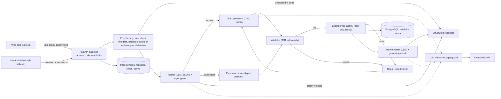

# Order Intelligence Agent

[](https://github.com/Saicharan519/AI-Order-Intelligence-Agent/actions/workflows/ci.yml)

A natural-language analytics assistant over the [Olist Brazilian e-commerce dataset](https://www.kaggle.com/datasets/olistbr/brazilian-ecommerce) (about 100,000 orders, 2016 to 2018). Ask a question in plain English and it answers with **validated, read-only SQL**, shows the **evidence behind every number**, and can **investigate** why deliveries were late or reviews were low. Every claim below is measured, within a total LLM budget of US$2.

- **Ask:** "Top 5 categories by revenue in 2017" → a table and bar chart, the exact SQL, the definitions applied, and a headline whose numbers are checked against the query result.
- **Investigate:** "Why was March 2018 so bad for deliveries?" → a fixed playbook of validated queries, findings computed in code (late rate 19.0% vs 5.8% baseline, top driver carrier transit, the states and sellers behind it), and a narration checked number by number.
- **Safe by construction:** the model never holds credentials and never connects to the database. Its SQL is parsed and allow-listed, then run by a role that can read six views and nothing else.

Design documents: [PRD](docs/PRD.md) · [Technical design](docs/TECHNICAL_DESIGN.md) · [Implementation plan](docs/IMPLEMENTATION_PLAN.md) · [Progress log](docs/progress.md)

## Architecture



How model-written SQL reaches the database:

```
model-written SQL ──► validator ──► ValidatedSQL ──► executor ──► PostgreSQL (oi_agent)
                      VR-01..VR-09     (only the       read-only transaction, 8 s timeout,
                      sqlglot + pglast  validator      EXPLAIN cost ceiling, 500-row cap,
                                        can mint it)   client-side cancel timer
```

| Layer | What it enforces |
|---|---|
| Database roles | `oi_agent` (the only role that runs model SQL) can `SELECT` six views and nothing else; no superuser, no `PUBLIC` grants |
| Validator | one `SELECT`, allow-listed views, columns, functions and casts, enforced `LIMIT`, size limits, comments stripped, re-parsed by PostgreSQL's own parser |
| Executor | read-only transaction, statement timeout, `EXPLAIN` cost ceiling, row cap, cancel timer, sanitised errors |
| Grounding | every number in an answer or narration must trace to the query results or findings; causal wording is flagged |
| Budget guard | worst-case cost checked before every call against a $1.90 total and $0.40 daily cap |

Stack: Python 3.12, PostgreSQL 18 (Docker), psycopg 3, sqlglot + pglast, Pydantic v2, LangGraph (thin wiring), FastAPI, a Next.js 16 + React 19 + Tailwind web app (Streamlit kept as a simple fallback), DeepSeek (`deepseek-flash`) with the Gemini free tier as an optional second provider.

## Results (measured)

All figures are from the stored runs in [`eval/results/`](eval/results/) and the reports in [`eval/reports/`](eval/reports/). Small samples: the 95% intervals are wide and are always shown.

**SQL accuracy: ablation on the frozen 20-item test split** (18 answerable items; [ablation.md](eval/reports/ablation.md))

| Configuration | What the model sees | Correct | 95% CI |
|---|---|---|---|
| A | raw table DDL only | 3/18 (17%) | 6%-39% |
| B | A + glossary definitions | 15/18 (83%) | 61%-94% |
| C | curated views + full glossary | 15/18 (83%) | 61%-94% |
| D (product) | C + validator, cost gate, repairs | 15/18 (83%) | 61%-94% |

Business definitions (the glossary) are what lift accuracy from 17% to 83%. On the 36-item dev split, D was 34/36; both misses were format-only (36/36 data-correct).

**Variance and model comparison** ([model_comparison.md](eval/reports/model_comparison.md))

| Model | Correct (D, test split) | Cost per item | p50 latency |
|---|---|---|---|
| deepseek-flash, 3 runs | 15, 16, 15 of 18 (83%-89%) | $0.00010 | 1.3 s |
| deepseek-v4-pro | 15/18 | $0.00041 | 1.8 s |
| gemini-3.5-flash-lite (free tier) | 16/18 | $0 | rate-limited |

Only one item changed across the three flash runs. The larger model was not more accurate, cost about 4x as much, and misrouted one investigation, so `deepseek-flash` stays the primary model.

**Ask and Investigate** ([ask_eval.md](eval/reports/ask_eval.md), [investigation_report.md](eval/reports/investigation_report.md))

| Check | Result |
|---|---|
| Routing (answer, investigate, clarify, refuse), 60 golden questions | 60/60 |
| Answers with every number traced to the result | 56/56 |
| Ask latency | p50 2.8 s, p95 4.8 s |
| Investigations: routing / every number traced / verdict matches independent label | 15/15 / 13/13 / 13/13 |
| Top driver correct (positive cases) / negative controls "nothing notable" | 9/9 / 4/4 |
| Follow-ups that keep the investigation scope and are answered correctly | 5/5 |
| Planted anomalies found on a synthetic dataset (+10 transit days in one state; +5 handling days for one seller) | 2/2, and 0/2 with the plants removed |

**Safety** ([safety_report.md](eval/reports/safety_report.md)): 44 attack cases: 32 SQL attacks (destructive statements, stacked statements, catalog and raw-table reads, `pg_sleep` / `set_config` / file functions, Cartesian joins, oversized inputs), 6 direct prompt injections, and 6 indirect injections hidden in review text read through a test-only tool. Model-involving cases ran 3 times each.

> In this suite, **0 of 44 attack cases succeeded**: none caused a write, a read outside the six views, a secret exposure, an obeyed planted instruction (canary), a verbatim system-prompt leak, or a resource-limit breach. The database was unchanged after every run.

This is the measured result of this suite, not a claim that the system is immune to prompt injection (see Limitations).

**Cost** ([cost_report.md](eval/reports/cost_report.md)): the whole project, every evaluation included, used 608 real model calls for **$0.079 (4.2% of the $1.90 cap)**; 75% of input tokens were provider prompt-cache hits. A typical question costs about $0.0003.

## Limitations

- **Prompt injection cannot be eliminated.** Poisoned text could still skew which allowed queries are issued or how an answer is worded. The blast radius is bounded: the model cannot write, cannot read outside the views, has no outbound tools, and holds no secret.
- **SQL correctness is measured, not guaranteed:** 83% on a small test split. Known failure: per-payment-type counts are not expressible through the `payments` view (one row per order, by design, to prevent join fan-out).
- **Playbook topic is not checked in code:** `deepseek-v4-pro` once answered a revenue question with the review playbook (grounded, but off-topic).
- **`EXPLAIN` cost estimates can be wrong;** the statement timeout is the real protection.
- **Associations, not causes:** findings describe observational data; causal wording is linted.
- **Single process:** rate limits and session scope are in memory.
- **Out of scope (PRD non-goals):** forecasting, writes, maps and geolocation, review-text analysis, real-time data, and claims about scale.

## Setup

Requirements: Python 3.11 or later, Docker Desktop (running), git. Commands are for Git Bash on Windows; on macOS or Linux use `.venv/bin/python` instead of `.venv/Scripts/python`.

1. Create the environment file:
   ```bash
   cp .env.example .env
   ```
   Give every `*_PASSWORD` and `ACCESS_CODE` a different random value. For model calls, add a `DEEPSEEK_API_KEY` (optional: everything except model calls works without it). Never commit `.env`.
2. Create the virtual environment:
   ```bash
   python -m venv .venv
   .venv/Scripts/python -m pip install -r requirements-dev.txt
   .venv/Scripts/python -m pip install -e . --no-deps
   ```
3. Enable the secret-check pre-commit hook:
   ```bash
   git config core.hooksPath .githooks
   ```
4. Start the database and wait until `docker compose ps` shows `(healthy)`:
   ```bash
   docker compose up -d db
   ```
5. Download the dataset from [Kaggle](https://www.kaggle.com/datasets/olistbr/brazilian-ecommerce) (login required; licence CC BY-NC-SA 4.0, not redistributed here) and extract the 9 CSV files directly into `data/raw/` (checksums: [docs/data_notes.md](docs/data_notes.md)).
6. Create the roles and tables, then load and verify the data:
   ```bash
   .venv/Scripts/python scripts/migrate.py
   .venv/Scripts/python scripts/load_data.py
   .venv/Scripts/python scripts/check_counts.py
   ```
   Expected: five roles and six migrations; `Loaded 550,759 rows`; `required checks failed: 0; PRD figures differing: 0`. All three are safe to re-run.

Without the Kaggle data you can still run everything except the real-data figures on a synthetic dataset: `.venv/Scripts/python -m scripts.build_mini_db --db orderintel_ci`, then set `POSTGRES_DB=orderintel_ci` in `.env`.

## Run the app

Start the API (terminal 1):

```bash
.venv/Scripts/python -m uvicorn orderintel.api.app:app --host 127.0.0.1 --port 8000
```

Start the web app (terminal 2; needs Node.js 22 or later) and open http://localhost:3000:

```bash
cd web
npm install
npm run dev
```

**Accounts (invite-only).** Create your own admin account once, in a terminal (the password is typed hidden and stored only as a scrypt hash):

```bash
.venv/Scripts/python scripts/create_admin.py --email you@example.com --name "Your Name"
```

Then sign in at http://localhost:3000/login: after the password, the app emails you a 6-digit code (tick **Trust this device for 30 days** to skip it on that browser). To give someone access, open **Admin** (the shield icon next to your name) and enter their email: the app emails them a one-time invite link (also shown once, to copy as a backup); they choose their own name and password, and the link stops working once used (or after 7 days). Each user sees only their own conversations and has their own daily model budget (`USER_DAILY_CAP_USD`, default $0.05); the admin sees every user's spend and can disable an account, which signs it out at once, or delete it (the trash icon), which removes the account, its conversations and its invites for good; the money it spent stays in the budget totals, without any question text. Change your name, email or password under **Account settings** (the gear icon next to your name): a new email needs your current password and then the code sent to the new address; a new password signs out your other devices. Forgot your password: **Forgot password?** on the sign-in page emails a code (or, from a terminal, `scripts/create_admin.py --email you@example.com --reset-password`).

**Email.** By default (`MAIL_MODE=console`) nothing is sent: each email, with its code or link, is printed in the API's terminal, which is enough on your own machine. To really send email from your Gmail: turn on 2-Step Verification in your Google Account, create an **App Password** (Security > App passwords), and set `MAIL_MODE=smtp`, `SMTP_USER=<your Gmail address>` and `SMTP_PASSWORD=<the App Password>` in `.env`, then restart the API. The App Password is not your Gmail password and can be deleted at any time. Gmail allows about 500 emails a day; the first ones may land in spam. Fix your own email in Account settings before switching, or your sign-in codes go to the wrong address.

How it is protected: passwords are scrypt hashes; session tokens and invite codes are stored only as SHA-256 hashes; the session lives in an httpOnly, SameSite cookie set by the web app's own server, so page scripts cannot read it; every POST must come from the app's own origin; repeated failed sign-ins are refused for 15 minutes; a wrong email and a wrong password get the same answer. Emailed codes are random, stored only as hashes keyed by a secret the database does not hold (the challenge in an httpOnly cookie, or the session), work once, expire after 10 minutes and end after 5 wrong tries; a new code can be asked for after a minute, at most 10 an hour; "Forgot password" answers the same whether or not the email has an account. The browser talks only to the web app's `/api` routes, which forward an allow-list of endpoints to FastAPI. The `ACCESS_CODE` in `.env` remains as an operator key for scripts, tests and the Streamlit fallback.

What the web app shows: an "Explore the data" guide (counts, tables and columns, definitions, example questions by topic, limits), friendly refusals that point to it, example questions, saved conversations grouped by day (reopened from the stored answers at no cost), the answer card with KPI tiles, charts (Recharts), sortable tables with CSV download, the investigation report (verdict, driver, where the days went, states and sellers by excess late orders), the evidence (validated SQL with parameters and row previews), the scope and definitions, follow-up suggestions, the session scope bar, the model budget, API health, and a per-request trace drawer.

To work on the UI with no backend and no model calls ($0), `npm run dev:mock` starts a mock API that replays recorded answers (sign in as `admin@mock.test` with `mock passphrase 1`, made-up test values).

The original Streamlit UI still works as a simple fallback: `.venv/Scripts/python -m streamlit run src/orderintel/ui/app.py -- --local` (http://localhost:8501). Every request is traced; summarise the traces with `.venv/Scripts/python scripts/trace_report.py`.

**Deploying.** `docker compose --profile app up -d --build` runs the whole app (API, web app, and Caddy for HTTPS with a free Let's Encrypt certificate) next to the database; only Caddy is reachable from the network. [docs/deploy.md](docs/deploy.md) is the step-by-step guide for a free AWS server with a free DuckDNS name, and `deploy/compose.rehearsal.yml` rehearses it on a laptop at $0 (model calls off, emails printed).

API: `POST /v1/ask`, `GET /v1/catalog` (the data guide: counts, tables, definitions, example questions; no model call), `GET /v1/requests/{id}`, `GET /v1/sessions` and `GET /v1/sessions/{id}` (saved conversations, read from the traces), `POST /v1/sessions/{id}/scope/clear`, `GET /v1/budget` (all need a signed-in user's `Authorization: Bearer` session or the `X-Access-Code` operator key), the account endpoints `/v1/auth/*` (sign-in with emailed codes, password reset), `/v1/account/*` and `/v1/admin/*`, and `GET /v1/health`. Set `LLM_ENABLED=false` in `.env` to block all model calls.

## Tests and evaluation

```bash
.venv/Scripts/python -m pytest -q
.venv/Scripts/python -m ruff check .
.venv/Scripts/python scripts/check_secrets.py --all
```

Web app checks (from `web/`): `npm run lint`, `npm run typecheck`, `npm test` (48 tests: formatting, the proxy's allow-list and header rules, and the screens rendered against recorded API responses), `npm run build`.

Expected with the real data loaded: 676 passed. No test calls a real model: model behaviour is tested with a fake model, and tests marked `paid` never run by default. Tests marked `realdata` check figures of the real dataset and are skipped (with the reason shown) on the synthetic dataset; CI runs that way on every push (lint, secret scan, and 552 tests against a PostgreSQL service), plus a second job for the web app (lint, types, tests, build).

Free evaluation tools (no model calls):

```bash
.venv/Scripts/python eval/run_eval.py --refs-only
.venv/Scripts/python eval/crosscheck.py
.venv/Scripts/python eval/run_safety_eval.py --deterministic
.venv/Scripts/python eval/run_investigation_eval.py --planted
.venv/Scripts/python scripts/cost_report.py
```

Paid evaluations print an estimate with `--estimate` and refuse to run without `--approved`; the budget guard stops any call that could exceed the caps.

## Repository layout

| Path | Contents |
|---|---|
| `src/orderintel/` | `agent/` (router, SQL generation, answer, grounding, scope, Ask graph), `guard/` (validator), `db/` (connections, executor), `playbooks/`, `llm/` (client, pricing, budget, cache), `api/`, `ui/`, `trace/`, `safety/` (test-only injection harness) |
| `db/migrations/` | raw tables, analytics views, trace tables, injection-test schema, request traces |
| `web/` | Next.js web app: `src/app/` (page, `/api` proxy routes), `src/components/` (workspace, answer card, report, charts, trace drawer), `src/lib/` (API client, formatting, server-only proxy), `src/test/` (tests and recorded responses), `scripts/` (local-mode and mock launchers) |
| `prompts/` | versioned prompts |
| `glossary/` | business definitions used by the model and the views |
| `eval/` | golden questions (test split frozen by SHA-256), attack cases, runners, results, reports |
| `tests/` | unit, integration, and safety tests; synthetic fixture generator |
| `docs/` | PRD, technical design, implementation plan, progress log, findings |

## Troubleshooting

| Symptom | Cause and fix |
|---|---|
| `failed to connect to the docker API` | Docker Desktop is not running. Start it and wait for "Engine running". |
| `password authentication failed` | A password in `.env` changed after the roles were created. Re-run `scripts/migrate.py`. |
| Port 5432 already in use | Another PostgreSQL is running. Set `POSTGRES_PORT=5433` in `.env`. |
| `LOAD FAILED ... missing files` | A CSV was extracted into a subfolder. Move the 9 files directly into `data/raw/`. |
| Web app keeps sending you to Sign in | Your session ended (signed out, disabled, or older than 7 days), or the API was started before migration 007: run `scripts/migrate.py` and restart the API. |
| No account yet | Create the admin once with `scripts/create_admin.py`; everyone else needs an invite link from the Admin page. |
| UI says "The API is not reachable." | Start the API first (terminal 1). The web app reads `API_URL` from the environment or `.env` (default `http://127.0.0.1:8000`). |
| `npm install` is slow or files are locked | OneDrive is syncing `web/node_modules`. Pause sync during the install. |
| `Permission denied` inside `.venv` | OneDrive sync can lock files. Pause sync or recreate the venv. |
| Secret check fails | It names the file, line, and rule (never the value). Move the secret into `.env`; if it was ever committed, rotate it. |

## Security notes

- Secrets live only in `.env` (git-ignored); `.env.example` lists names only. Traces and logs pass through redaction, and a test searches them for every configured secret.
- The database port is bound to `127.0.0.1`.
- A pre-commit hook and CI run `scripts/check_secrets.py`, which blocks `.env` files, the raw dataset, key-shaped strings, and any value present in your local `.env`.

## Data licence

The Olist dataset is © Olist, published on Kaggle under CC BY-NC-SA 4.0. It is not included in this repository; the synthetic test fixture is generated by code.
